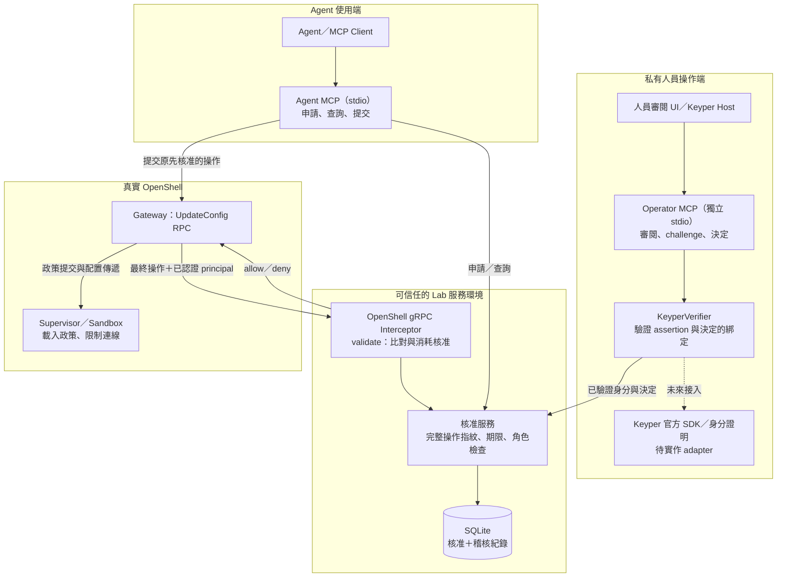
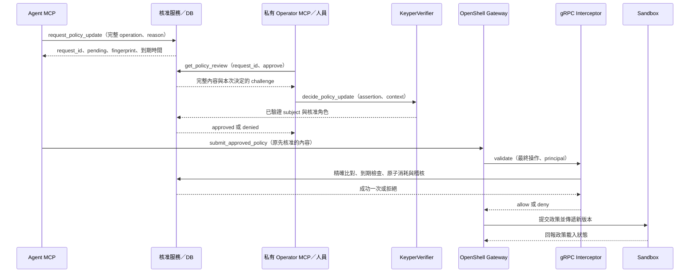

# OpenShell–Keyper Approval Lab

讓 Agent 擴充 OpenShell sandbox 的網路權限前，先由人員審閱並核准**一筆明確的政策變更**。
核准綁定 gateway、請求人、workspace、sandbox、版本、目的地與允許使用的程式，並且只能消耗一次。

**目前進度：真實 OpenShell v0.1.6 已打通；Keyper 真實身分驗證待串接。**
獨立 Ubuntu VM 已驗證：未核准被拒 → 私有 MCP 模擬人員核准 → Agent MCP 提交 →
sandbox 載入政策版本 2 → HTTPS 成功；未核准目的地與重放仍被拒絕。
Windows 與 Linux 各有 73 個測試通過。[查看驗收證據](docs/live-validation.zh-TW.md)。

這是獨立實驗專案，沒有修改 OpenShell 原始碼，也不代表 NVIDIA 背書或正式合作。

## 先選擇執行模式

| 你想做什麼 | 需要什麼 | 真實政策變更 | 入口 |
| --- | --- | --- | --- |
| 第一次了解申請、核准與一次使用 | Git、Python 3.11+、uv | 無，全部模擬 | [第一次啟動](#第一次啟動) |
| 開發 MCP／Keyper 接口，驗證 gRPC 協定 | 同上，加上 openshell extra | 無，gateway 使用測試端 | [MCP 協定測試](#mcp-協定測試) |
| 驗證真實 OpenShell sandbox | 獨立 Linux、Docker、官方 v0.1.6 執行檔 | 有，建立測試 sandbox 並更新政策 | [真實驗收](#真實-openshell-驗收linux) |

**第一次先跑模擬即可，不需要 Keyper 帳號、API key、Docker 或 OpenShell。**
首次安裝依賴需要網路。`uv.lock` 固定依賴版本；以下指令均從專案根目錄執行。

## 整體架構



Operator MCP 由可信人員操作端使用，與 Agent 的 MCP 設定分開。
目前 lab 服務可共用本機 DB；能直接讀寫 DB 的作業系統使用者是可信操作者。
正式部署需要將 Agent、資料庫與人員核准端的權限隔離。

### 一筆申請的完整流程



`approved` 是審閱結果；interceptor 會在 gateway 執行路徑重新檢查。
gateway 回覆成功後，還要確認 sandbox 已載入政策與實際連線結果。

## 第一次啟動

### 1. 安裝工具，Fork 並 Clone

安裝 [Git](https://git-scm.com/downloads)、[Python 3.11+](https://www.python.org/downloads/)
與 [uv](https://docs.astral.sh/uv/getting-started/installation/)。
在 GitHub 按 **Fork → Create fork**，把以下 `YOUR_GITHUB_USERNAME` 換成自己的帳號：

```bash
git clone https://github.com/YOUR_GITHUB_USERNAME/openshell-keyper-lab.git
cd openshell-keyper-lab
python --version
uv --version
```

Linux 若只有 `python3`，版本檢查改用 `python3 --version`。
Fork 是 GitHub 上的副本，`git clone` 才會將程式下載到電腦。

### 2. 跑完整模擬

Windows、Linux、macOS 都可以從這組指令開始：

```bash
uv sync --locked
uv run --locked python -m approval_lab.demo
uv run --locked pytest -q
```

demo 最後預期顯示：

```text
PASS: no real network rule or OpenShell policy was changed.
```

demo 使用暫存 SQLite，實際啟動 MCP stdio 與另一個核准 CLI 程序，測試未核准、
無核准權限、不同 port、成功套用一次與重放。正常結束後清除 demo 的暫存資料庫。

未安裝 `openshell` extra 時，基本測試預期為 **50 passed、1 skipped**；
安裝 extra 後執行完整 73 個測試。目前保存的跨平台驗收證據來自 Windows／Linux。

### Windows：專用資料夾模式

希望保留原專案 Python 環境時，改跑：

```powershell
powershell.exe -NoProfile -ExecutionPolicy Bypass -File .\scripts\run-local-lab.ps1
```

腳本使用既有 Python，建立專案副本、專用 venv、快取、暫存與報告，放在
`.approval-lab/isolated-run/<當次目錄>/`。`reports/summary.json` 會列出 Python 與資料庫路徑。
執行原則參數只作用於這次子程序；腳本不修改永久原則或系統 PATH。
資料夾模式使用目前 Windows 權限，沒有 OS／網路隔離；真實 OpenShell 請使用獨立 Linux 環境。

## 怎麼使用：手動申請與核准

以下是本機 mock CLI，不會修改真實 OpenShell 政策。PowerShell 可直接執行：

```powershell
$request = uv run --locked approval-lab request --sandbox sandbox-demo --domain api.example.com --port 443 --reason "Read the example API" | ConvertFrom-Json
$requestId = $request.request_id
uv run --locked approval-lab status $requestId
uv run --locked approval-lab approve $requestId --identity demo-approver
uv run --locked approval-lab apply $requestId --sandbox sandbox-demo --domain api.example.com --port 443
uv run --locked approval-lab apply $requestId --sandbox sandbox-demo --domain api.example.com --port 443
uv run --locked approval-lab audit $requestId
```

第一次 `apply` 回傳 `applied=true, simulated=true`；第二次回傳 `already_consumed`，exit code 1。
拒絕申請可用 `uv run --locked approval-lab deny <request_id> --identity demo-approver`。
Linux／macOS 可先執行 `request`，把輸出的 request ID 填入後續指令，取代 PowerShell 變數。

| 測試身分 | 行為 |
| --- | --- |
| `demo-approver` | 可核准或拒絕 |
| `demo-viewer` | 身分存在，但無核准角色 |
| 其他名稱 | 身分驗證失敗 |

這些名稱是 mock 測試選擇器。預設 DB 為 `.approval-lab/approvals.sqlite3`；
申請自建立起五分鐘到期。跨程序共用資料時，請使用相同的絕對 `--db` 路徑。

## MCP 協定測試

Windows 專用資料夾：

```powershell
powershell.exe -NoProfile -ExecutionPolicy Bypass -File .\scripts\run-local-lab.ps1 -OpenShell
```

一般 Python 開發環境：

```bash
uv sync --locked --extra openshell
uv run --locked --extra openshell pytest -q
```

預期 **73 passed**。這裡使用真正的雙 MCP stdio 與 gRPC，gateway 是協定測試端，
不會建立真實 OpenShell sandbox。

## 把 MCP 接到自己的 Client

### 基本 mock MCP

```bash
uv run --locked approval-lab-mcp --db /absolute/path/to/approvals.sqlite3
```

stdio server 會等待 MCP Client 請求，沒有網頁介面；停在終端機等待是正常行為，
按 `Ctrl+C` 結束。通用 Client 設定範例，請替換專案與 DB 絕對路徑：

```json
{
  "mcpServers": {
    "approval-lab-mock": {
      "command": "uv",
      "args": [
        "run", "--locked", "--directory", "C:/path/to/openshell-keyper-lab",
        "approval-lab-mcp", "--db", "C:/path/to/approvals.sqlite3"
      ]
    }
  }
}
```

此 server 提供 `request_network_access`、`get_approval_status`；人員決定由另一個 CLI 處理。
設定格式依你的 MCP Client 調整，本專案不自動修改任何 Client 設定。

### 真實 OpenShell bridge 的 MCP 接口

| 使用端 | Tool | 用途 |
| --- | --- | --- |
| Agent | `request_policy_update(operation, reason)` | 申請完整 UpdateConfig 操作 |
| Agent | `get_policy_approval(request_id)` | 查詢狀態與原始審閱內容 |
| Agent | `submit_approved_policy(request_id)` | 提交原先核准的內容給固定 gateway |
| 私有 Operator／Keyper Host | `get_policy_review(request_id, approve)` | 取得審閱內容與本次決定的 challenge |
| 私有 Operator／Keyper Host | `decide_policy_update(request_id, approve, assertion)` | 驗證身分證明與角色後記錄決定 |

Agent 使用 [agent-mcp.example.json](examples/openshell/agent-mcp.example.json)。
人員端使用另一份 [keyper-operator-mcp.example.json](examples/openshell/keyper-operator-mcp.example.json)，
放在各自的 Client／可信 Host，替換 Python、config、DB 絕對路徑。
已匯出的 [Agent schema](examples/openshell/agent-tools.schema.json) 與
[Operator schema](examples/openshell/operator-tools.schema.json) 可交給整合團隊，測試會檢查與 runtime 一致。

## 真實 OpenShell 驗收：Linux

使用獨立、可丟棄的 **Ubuntu 24.04 x86_64** 測試機，先安裝 Python 3.11+、uv、
[Docker Engine](https://docs.docker.com/engine/install/ubuntu/)，確認目前使用者有 Docker 權限：

```bash
docker version
docker run --rm hello-world
```

已驗收環境為 Docker 29.1.3、OpenShell v0.1.6。以下會下載映像、建立測試 sandbox、
更新政策並探測連線，請在專用測試機執行。

### 1. 準備 Linux 環境

```bash
bash scripts/prepare-linux-lab.sh
```

腳本建立 `.approval-lab/linux-run/<當次目錄>/venv` 並跑 demo 與 73 個測試，
最後印出專用 Python 路徑。它不安裝 Docker 或 OpenShell 系統套件。

### 2. 下載固定版本並檢查校驗碼

```bash
mkdir -p .approval-lab/openshell-bin
cd .approval-lab/openshell-bin
release=https://github.com/NVIDIA/OpenShell/releases/download/v0.1.6

for component in gateway sandbox; do
  case "$component" in
    gateway) archive=openshell-gateway-x86_64-unknown-linux-gnu.tar.gz ;;
    sandbox) archive=openshell-sandbox-x86_64-unknown-linux-musl.tar.gz ;;
  esac
  curl -fL "$release/$archive" -o "$archive" || exit 1
  curl -fL "$release/openshell-$component-checksums-sha256.txt" -o "$component-sha256.txt" || exit 1
  grep " $archive$" "$component-sha256.txt" | sha256sum -c - || exit 1
  tar -xzf "$archive" || exit 1
done

curl -fL "$release/openshell-0.1.6-py3-none-any.whl" -o openshell-0.1.6-py3-none-any.whl || exit 1
echo 'a0c5b0e9954ffdbdb4d34110d4a9d0d2dc57579a53e4a67372e0f8dd3b75cd81  openshell-0.1.6-py3-none-any.whl' | sha256sum -c - || exit 1
cd ../..
```

SDK 校驗碼來自已驗證的官方發行檔；來源與 digest 見 [環境紀錄](docs/evidence/validation-environment.json)。
校驗失敗時停止，核對下載內容與版本。

### 3. 建立映像並執行真實驗收

```bash
bash scripts/build-live-workload.sh
lab_python="$(find "$PWD/.approval-lab/linux-run" -path '*/venv/bin/python' -print | sort | tail -n 1)"
"$lab_python" scripts/validate-live-openshell.py \
  --bin-dir "$PWD/.approval-lab/openshell-bin" \
  --sdk-wheel "$PWD/.approval-lab/openshell-bin/openshell-0.1.6-py3-none-any.whl"
```

腳本啟動這次驗收的 gateway 與 interceptor，建立唯一名稱 sandbox，透過雙 MCP 完成核准與提交；
結束時停止程序並要求刪除測試 sandbox。gateway 使用測試機內 loopback 與 local-dev 身分。
最後印出 `Evidence directory: ...`，其中 `report.json` 應含：

```json
{
  "real_gateway": true,
  "real_keyper": false,
  "success": true
}
```

報告也記錄 `runtime_policy_active_version=2`、核准前後 curl 結果與重放拒絕。
此驗收使用 `example.com` 作公開網站探測；正式環境請換成自有測試服務。
詳細環境、TLS 與版本競爭說明見 [真實驗收指南](docs/live-validation.zh-TW.md)。

### 接到既有 gateway

1. 複製 [config 範本](examples/openshell/config.example.json) 到 `.approval-lab/private/config.json`，填入實際 gateway、TLS CA 與 principal。
2. 啟動 interceptor，在 gateway 設定 `UpdateConfig`／`validate`、`fail_closed` 與明確 bindings，重啟 gateway。
3. 分開設定 Agent MCP 與 Operator MCP，使用相同的絕對 DB 路徑。
4. 複製 [操作範本](examples/openshell/add-network-rule.json)，修改 workspace、sandbox、目前版本、host、port、binary。
5. 用 `approval_lab.openshell_smoke` 建立申請；帶 `--submit` 才實際送出，mock 人員還需要 `--local-mock-keyper`。

完整指令與 TOML 範本見 [bridge 接線說明](docs/openshell-bridge.zh-TW.md)。
`submitted=true` 代表 gateway 已回覆，還要確認 runtime 載入與連線。

## Keyper 團隊怎麼接

目前真實 OpenShell 驗收明確使用 `--local-mock-keyper`。未設定 verifier 的操作端回傳
`keyper_not_configured`，沒有假設真實 Keyper API 或 token 格式。
從 [adapter 範本](examples/keyper_adapter_template.py) 開始，實作：

```python
def verify_decision(self, assertion: str, context: DecisionContext) -> Identity:
    # 以 Keyper 官方介面驗證 assertion、效期、context.challenge。
    # 從可信任授權來源取得 subject 與 roles，再回傳 Identity。
    ...
```

操作 UI 先呼叫 `get_policy_review`，顯示完整操作並取得 challenge；Keyper 身分證明需綁定它，
再交給 `decide_policy_update`。challenge 包含 request ID、操作指紋、核准／拒絕與到期時間，
單獨回傳 challenge 不是身分證明。

部署時指定可信工廠：

```bash
uv run --locked --extra openshell python -m approval_lab.openshell_mcp operator \
  --config /absolute/private/config.json \
  --db /absolute/private/bridge.sqlite3 \
  --keyper-verifier your_keyper_package.adapter:create_verifier
```

`network_approver` 角色由可信驗證／授權結果提供。未驗證的 assertion、Agent 提供的角色或
`approved=true` 都不能當作授權；assertion 不應寫入 log 或 Git。

## 怎麼修改與開發

| 想改的部分 | 主要檔案 | 修改後確認 |
| --- | --- | --- |
| Agent／Operator MCP | `src/approval_lab/openshell_mcp.py` | 更新 tool schema，兩端權限分開 |
| Keyper 驗證方式 | `keyper_adapter.py`、`examples/keyper_adapter_template.py` | challenge、效期、角色與錯誤拒絕 |
| 支援的真實政策變更 | `src/approval_lab/openshell_policy.py` | 完整操作納入指紋，修改後不能用舊核准 |
| gateway 呼叫與攔截 | `openshell_bridge.py`、`openshell_wire.py` | 固定官方協定一致、失敗時拒絕 |
| 持久化與一次使用 | `src/approval_lab/approval_store.py` | 消耗與稽核同交易、並發只成功一次 |
| 基本 mock | `demo.py`、`cli.py`、`mcp_server.py` | 無 OpenShell 的 demo 仍可執行 |
| 真實驗收 | `scripts/validate-live-openshell.py` | 真實 gateway、政策載入與連線 |

表中未列完整路徑的程式檔皆在 `src/approval_lab/`。建議流程：

```bash
git switch -c feature/my-change
uv sync --locked --extra openshell
# 修改檔案後，執行相關測試與完整協定測試。
uv run --locked --extra openshell pytest -q
git diff --check
git add README.md src tests examples docs
git commit -m "feat: describe your change"
git push -u origin feature/my-change
```

新增依賴使用 `uv add <package>`，提交 `pyproject.toml` 與 `uv.lock`。
修改 tool 時更新 `examples/openshell/*-tools.schema.json`；
`test_published_mcp_schemas_match_runtime` 會檢查與程式一致。
修改真實整合後，在測試機重跑驗收並更新證據；打包器比對已驗證來源雜湊，
來源改變後不會自動沿用舊的 `live_openshell_verified=true`。

## 範圍與限制

- 真實 bridge 目前只支援一筆 sandbox-scoped `addRule`：明確 workspace、非零版本、一個 DNS host／TCP port、一個絕對 Linux binary path。
- 核准自申請起五分鐘到期，成功消耗一次後不能重用；操作不符時不消耗正確核准。
- denial analysis 等觀察事件也可能更新 resource version；核准後版本衝突須新建申請、重新核准。
- 核准消耗後 gateway 失敗，本版不恢復核准、不自動重試；跨系統交易與正式重試語意待設計。
- 目前治理 UpdateConfig；CreateSandbox、其他管理／草稿路徑需另行治理。
- SQLite 與 mock 身分供可信 lab host 使用；真實 Keyper 與正式部署權限隔離仍待完成。

## 常見問題

| 現象 | 處理方式 |
| --- | --- |
| pytest 連續 `EEEE...`、暫存目錄 Access denied | Windows 優先跑 `run-local-lab.ps1`，使用當次專用暫存目錄 |
| 找不到 grpc／google.protobuf | 安裝 `uv sync --locked --extra openshell`，執行時也帶 extra |
| MCP 停在終端機 | stdio 正在等 Client，從 MCP Client 連接或先跑 demo |
| keyper_not_configured | 設定自己的 verifier；隔離實驗才用 local-mock-keyper |
| change_mismatch／版本衝突 | 重新讀取操作與版本，新建申請並審閱 |
| gateway_rpc_* 或政策未載入 | 查看 gateway／interceptor 的私有 log、TLS、principal、版本與 runtime 狀態 |
| Fork 後找不到作者的 VM／venv | `.approval-lab/` 不進 Git，依本 README 重建環境或使用自己的 Linux 機器 |

`control-local-vm.py` 只管理已 provision 的 VM。`portable-vm` extra 提供管理工具，
不會自動建立 VM、下載磁碟或啟用 Windows 功能。

## 文件、交付與回報

- [基本 mock 操作](docs/quickstart.zh-TW.md) · [專用資料夾與清理](docs/local-lab.zh-TW.md)
- [OpenShell／Keyper 接線](docs/openshell-bridge.zh-TW.md) · [真實驗收與 VM](docs/live-validation.zh-TW.md)
- [整合邊界](docs/openshell-integration.md) · [官方協定來源](src/approval_lab/openshell_proto/SOURCE.md)

建立來源交付包：

```bash
uv run --locked python scripts/package-deployable.py
```

ZIP、manifest 與 SHA-256 放在 `.approval-lab/releases/`，不含 VM 磁碟、快取、DB、私鑰或 `.env`。
Git 與 Fork 也不會包含這些本機狀態。

問題請到 [GitHub Issues](https://github.com/pecutsai-dev/openshell-keyper-lab/issues)，附上 OS、Python／uv 版本、
執行模式、重現步驟、預期／實際結果與去識別錯誤片段。
分享修改時，推送自己的 fork 分支，再向本專案開 Pull Request。

官方參考：[MCP Python SDK 1.x](https://github.com/modelcontextprotocol/python-sdk/tree/v1.x)、
[OpenShell](https://github.com/NVIDIA/OpenShell)、
[Gateway Interceptors](https://docs.nvidia.com/openshell/extensibility/gateway-interceptors)。
