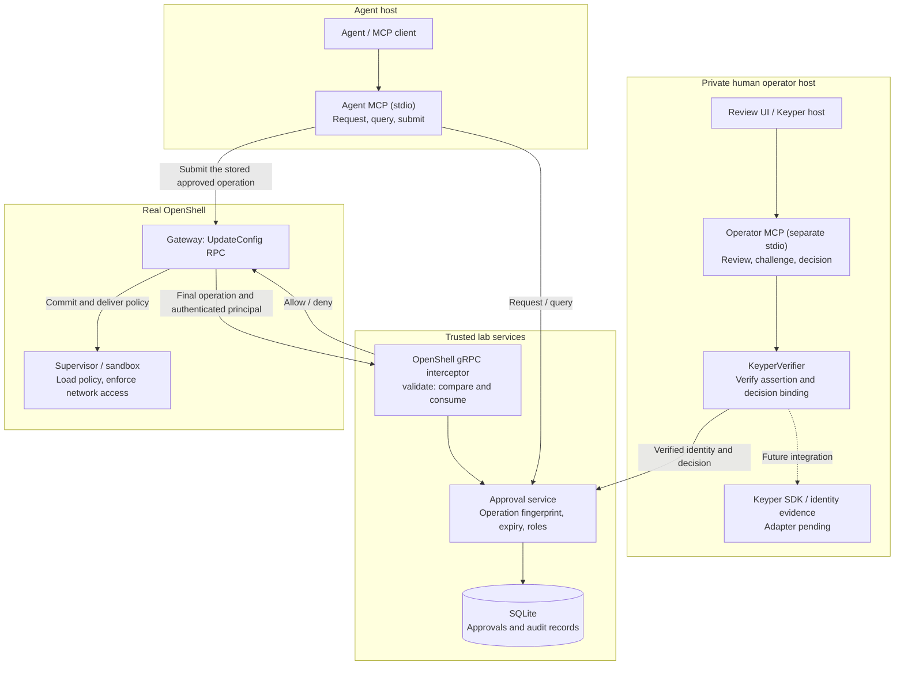
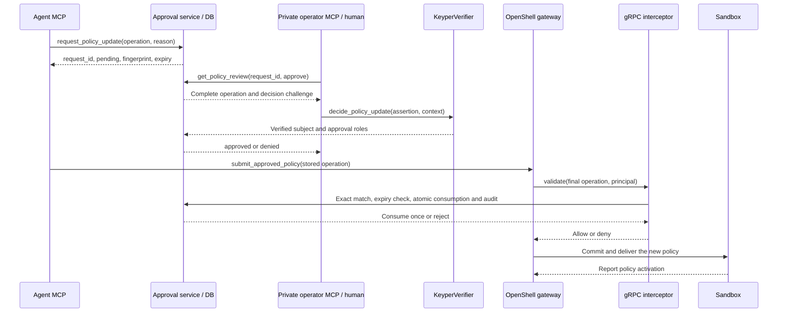

# OpenShell–Keyper Approval Lab

**English** | [繁體中文](README.zh-TW.md)

Require human review before an agent expands an OpenShell sandbox's network permissions.
Each approval binds one exact operation to its gateway, requester, workspace, sandbox,
resource version, destination and executable, and can be consumed only once.

**Status: real OpenShell v0.1.6 integration verified; real Keyper authentication pending.**
A separate Ubuntu VM verified the complete flow: reject an unapproved change, approve through
the private operator MCP, submit through the agent MCP, activate policy version 2, and establish
HTTPS connectivity. Other destinations and replayed submissions remained blocked.
Windows and Linux each passed 73 tests. See the [recorded evidence](docs/evidence/openshell-v0.1.6-live.json).

This independent experiment leaves OpenShell source unchanged and does not imply NVIDIA
endorsement or an official partnership.

## Choose a mode

| Your goal | Requirements | Real policy changes | Start here |
| --- | --- | --- | --- |
| Learn requests, human decisions and single use | Git, Python 3.11+, uv | None; simulated | [Quickstart](#quickstart) |
| Develop MCP/Keyper interfaces and test gRPC | The above, plus the openshell extra | None; a gateway test peer | [Protocol tests](#mcp-protocol-tests) |
| Verify a real OpenShell sandbox | Separate Linux host, Docker, official v0.1.6 binaries | Creates a test sandbox and updates its policy | [Live validation](#live-openshell-validation-linux) |

**Start with the mock demo. It requires no Keyper account, API key, Docker or OpenShell.**
The first dependency installation needs network access. `uv.lock` pins dependencies.
Run the commands below from the repository root unless instructed otherwise.

## Architecture



Connect the operator MCP to a trusted human-facing host, separately from the requesting agent.
Lab services can share a local database; OS users who can directly access it are trusted operators.
Production deployment requires permission separation between the agent, database and decision service.

### Complete request flow



`approved` describes the review outcome. The interceptor checks authorization again on the gateway path.
After gateway acknowledgement, verify runtime policy activation and connectivity separately.

## Quickstart

### 1. Install tools, fork and clone

Install [Git](https://git-scm.com/downloads), [Python 3.11+](https://www.python.org/downloads/)
and [uv](https://docs.astral.sh/uv/getting-started/installation/).
On GitHub, select **Fork → Create fork**. Replace `YOUR_GITHUB_USERNAME` with your account:

```bash
git clone https://github.com/YOUR_GITHUB_USERNAME/openshell-keyper-lab.git
cd openshell-keyper-lab
python --version
uv --version
```

On Linux, use `python3 --version` if that is your Python command.
A fork is your GitHub copy; cloning downloads the code to your computer.

### 2. Run the complete mock demo

Start with these commands on Windows, Linux or macOS:

```bash
uv sync --locked
uv run --locked python -m approval_lab.demo
uv run --locked pytest -q
```

The demo should end with:

```text
PASS: no real network rule or OpenShell policy was changed.
```

It uses temporary SQLite storage, a real MCP stdio subprocess and a separate operator CLI process.
It checks unapproved access, unauthorized identities, changed ports, a successful single use and replay.
The demo database is removed on normal completion.

Without the `openshell` extra, expect **50 passed, 1 skipped**. Installing that extra enables all
73 tests. Recorded cross-platform verification covers Windows and Linux.

### Windows: dedicated folder environment

To preserve the existing project Python environment, use:

```powershell
powershell.exe -NoProfile -ExecutionPolicy Bypass -File .\scripts\run-local-lab.ps1
```

The script reuses an installed Python and creates a source copy, dedicated venv, cache, temporary
files and reports under `.approval-lab/isolated-run/<run>/`. Its `reports/summary.json` lists the
Python and database paths. The execution-policy option applies only to this child process;
the script does not change permanent policy or system PATH.
Folder organization uses your current Windows permissions and provides no OS/network isolation.
Use a separate Linux environment for live OpenShell testing.

## Use the mock CLI

These commands simulate policy changes. In PowerShell:

```powershell
$request = uv run --locked approval-lab request --sandbox sandbox-demo --domain api.example.com --port 443 --reason "Read the example API" | ConvertFrom-Json
$requestId = $request.request_id
uv run --locked approval-lab status $requestId
uv run --locked approval-lab approve $requestId --identity demo-approver
uv run --locked approval-lab apply $requestId --sandbox sandbox-demo --domain api.example.com --port 443
uv run --locked approval-lab apply $requestId --sandbox sandbox-demo --domain api.example.com --port 443
uv run --locked approval-lab audit $requestId
```

The first `apply` returns `applied=true, simulated=true`. The second returns `already_consumed`
and exit code 1. To deny, run `uv run --locked approval-lab deny <request_id> --identity demo-approver`.
On Linux/macOS, run `request` first and paste the returned ID into subsequent commands instead
of using the PowerShell variables.

| Test identity | Behavior |
| --- | --- |
| `demo-approver` | Can approve or deny |
| `demo-viewer` | Known identity without the approval role |
| Any other name | Identity verification fails |

These names are mock test selectors. The default database is `.approval-lab/approvals.sqlite3`.
Requests expire five minutes after creation. Use the same absolute `--db` path across processes.

## MCP protocol tests

Windows dedicated folder:

```powershell
powershell.exe -NoProfile -ExecutionPolicy Bypass -File .\scripts\run-local-lab.ps1 -OpenShell
```

Standard development environment:

```bash
uv sync --locked --extra openshell
uv run --locked --extra openshell pytest -q
```

Expect **73 passed**. These tests use two real MCP stdio connections and gRPC with a gateway
protocol peer. They do not create a real OpenShell sandbox.

## Connect your MCP client

### Basic mock MCP

```bash
uv run --locked approval-lab-mcp --db /absolute/path/to/approvals.sqlite3
```

A stdio server waits for MCP client requests. Waiting in the terminal is normal; there is no web UI.
Press `Ctrl+C` to stop it. Example client configuration; replace the absolute paths:

```json
{
  "mcpServers": {
    "approval-lab-mock": {
      "command": "uv",
      "args": [
        "run", "--locked", "--directory", "C:/path/to/openshell-keyper-lab",
        "approval-lab-mcp", "--db", "C:/path/to/approvals.sqlite3"
      ]
    }
  }
}
```

This server exposes `request_network_access` and `get_approval_status`. Human decisions use
the separate CLI. Adapt configuration to your MCP client; the project does not edit client settings.

### OpenShell bridge tools

| Host | Tool | Purpose |
| --- | --- | --- |
| Agent | `request_policy_update(operation, reason)` | Request review of a complete UpdateConfig operation |
| Agent | `get_policy_approval(request_id)` | Read status and the original review content |
| Agent | `submit_approved_policy(request_id)` | Submit the stored approved operation to the configured gateway |
| Private operator / Keyper host | `get_policy_review(request_id, approve)` | Obtain review content and the decision challenge |
| Private operator / Keyper host | `decide_policy_update(request_id, approve, assertion)` | Verify identity evidence and roles, then record the decision |

Use [agent-mcp.example.json](examples/openshell/agent-mcp.example.json) for the agent, and
[keyper-operator-mcp.example.json](examples/openshell/keyper-operator-mcp.example.json) on a separate,
trusted operator host. Replace the Python, config and database paths.
Share the exported [agent schema](examples/openshell/agent-tools.schema.json) and
[operator schema](examples/openshell/operator-tools.schema.json) with integrators; tests compare them to runtime.

## Live OpenShell validation (Linux)

Use a separate, disposable **Ubuntu 24.04 x86_64** host with Python 3.11+, uv and
[Docker Engine](https://docs.docker.com/engine/install/ubuntu/). Confirm your user has Docker access:

```bash
docker version
docker run --rm hello-world
```

The verified environment used Docker 29.1.3 and OpenShell v0.1.6. The following steps download images,
create a test sandbox, change its policy and probe connectivity. Run them on your dedicated test host.

### 1. Prepare the Linux environment

```bash
bash scripts/prepare-linux-lab.sh
```

This creates `.approval-lab/linux-run/<run>/venv`, runs the demo and 73 tests, then prints its
Python path. It installs no Docker or OpenShell system packages.

### 2. Download and verify the pinned release

```bash
mkdir -p .approval-lab/openshell-bin
cd .approval-lab/openshell-bin
release=https://github.com/NVIDIA/OpenShell/releases/download/v0.1.6

for component in gateway sandbox; do
  case "$component" in
    gateway) archive=openshell-gateway-x86_64-unknown-linux-gnu.tar.gz ;;
    sandbox) archive=openshell-sandbox-x86_64-unknown-linux-musl.tar.gz ;;
  esac
  curl -fL "$release/$archive" -o "$archive" || exit 1
  curl -fL "$release/openshell-$component-checksums-sha256.txt" -o "$component-sha256.txt" || exit 1
  grep " $archive$" "$component-sha256.txt" | sha256sum -c - || exit 1
  tar -xzf "$archive" || exit 1
done

curl -fL "$release/openshell-0.1.6-py3-none-any.whl" -o openshell-0.1.6-py3-none-any.whl || exit 1
echo 'a0c5b0e9954ffdbdb4d34110d4a9d0d2dc57579a53e4a67372e0f8dd3b75cd81  openshell-0.1.6-py3-none-any.whl' | sha256sum -c - || exit 1
cd ../..
```

The SDK checksum comes from the verified official release asset. See the
[environment receipt](docs/evidence/validation-environment.json) for sources and digests.
Stop on checksum failure and check the downloaded content and release version.

### 3. Build images and run live acceptance

```bash
bash scripts/build-live-workload.sh
lab_python="$(find "$PWD/.approval-lab/linux-run" -path '*/venv/bin/python' -print | sort | tail -n 1)"
"$lab_python" scripts/validate-live-openshell.py \
  --bin-dir "$PWD/.approval-lab/openshell-bin" \
  --sdk-wheel "$PWD/.approval-lab/openshell-bin/openshell-0.1.6-py3-none-any.whl"
```

The script starts its own gateway and interceptor, creates a uniquely named sandbox, and drives
approval and submission through both MCP connections. On exit it stops its processes and requests
deletion of the test sandbox. The gateway uses host loopback and local-development authentication.
It prints `Evidence directory: ...`. The directory's `report.json` should contain:

```json
{
  "real_gateway": true,
  "real_keyper": false,
  "success": true
}
```

The report also records `runtime_policy_active_version=2`, before/after curl results and replay rejection.
The acceptance test probes the public `example.com` site. Use a service you control for production tests.
The [recorded live report](docs/evidence/openshell-v0.1.6-live.json) is language-neutral;
the [detailed VM, TLS and concurrency guide](docs/live-validation.zh-TW.md) is available in Traditional Chinese.

### Connect to an existing gateway

1. Copy the [config template](examples/openshell/config.example.json) to `.approval-lab/private/config.json`.
   Set the actual gateway target, TLS CA and complete expected authenticated principal map.
2. Start the interceptor and configure the gateway's UpdateConfig/validate binding as shown below.
3. Configure agent and operator MCP connections separately, using the same absolute DB path.
4. Copy the [operation template](examples/openshell/add-network-rule.json). Set the real workspace,
   sandbox, current resource version, destination and executable.
5. Use `approval_lab.openshell_smoke` to request review; `--submit` performs the actual mutation.
   Mock decisions additionally require explicit `--local-mock-keyper`.

On Linux, create a private directory, edit the copied config, then start the interceptor:

```bash
mkdir -m 700 -p .approval-lab/private
cp examples/openshell/config.example.json .approval-lab/private/config.json
# Edit config.json before starting services.
uv run --locked --extra openshell python -m approval_lab.openshell_mcp interceptor \
  --config "$PWD/.approval-lab/private/config.json" \
  --db "$PWD/.approval-lab/private/bridge.sqlite3" \
  --listen "unix:$PWD/.approval-lab/private/interceptor.sock"
```

Add this to the gateway TOML, replacing the socket path with the absolute path visible to the gateway,
then restart the gateway after the interceptor is ready:

```toml
[[openshell.gateway.interceptors]]
name = "approval-lab"
grpc_endpoint = "unix:///absolute/private/interceptor.sock"
order = 100
failure_policy = "fail_closed"
binding_policy = "exact"
timeout = "2s"

[[openshell.gateway.interceptors.bindings]]
rpc = "openshell.v1.OpenShell/UpdateConfig"
phases = ["validate"]
```

Start the agent MCP through your client using its example configuration. Start the private operator
with a real verifier as described in the next section. `submitted=true` means gateway acknowledgement;
verify runtime activation and connectivity afterward.
For additional configuration examples, see the [bridge guide (Traditional Chinese)](docs/openshell-bridge.zh-TW.md).

## Connect Keyper

Live OpenShell acceptance explicitly uses `--local-mock-keyper`. Without a configured verifier,
the operator returns `keyper_not_configured`. The project makes no assumptions about real Keyper API
endpoints or token formats. Start with the [adapter template](examples/keyper_adapter_template.py):

```python
def verify_decision(self, assertion: str, context: DecisionContext) -> Identity:
    # Verify assertion, expiry and context.challenge with the official Keyper API.
    # Resolve subject and roles from trusted authorization data, then return Identity.
    ...
```

The operator UI calls `get_policy_review`, displays the complete operation and obtains the challenge.
Bind Keyper identity evidence to that challenge before calling `decide_policy_update`.
The challenge covers request ID, operation fingerprint, approve/deny and expiry. Returning the
challenge alone is not identity evidence.

Configure a trusted verifier factory:

```bash
uv run --locked --extra openshell python -m approval_lab.openshell_mcp operator \
  --config /absolute/private/config.json \
  --db /absolute/private/bridge.sqlite3 \
  --keyper-verifier your_keyper_package.adapter:create_verifier
```

The `network_approver` role must come from trusted verification/authorization results.
Unverified assertions, agent-supplied roles and `approved=true` are not authorization evidence.
Keep assertions out of logs and Git.

## Modify and develop

| Change | Main files | Verify afterward |
| --- | --- | --- |
| Agent/operator MCP tools | `src/approval_lab/openshell_mcp.py` | Update tool schemas; preserve role separation |
| Keyper verification | `keyper_adapter.py`, `examples/keyper_adapter_template.py` | Challenge, expiry, roles and failure rejection |
| Supported policy changes | `src/approval_lab/openshell_policy.py` | Fingerprint the complete operation; reject changed approved content |
| Gateway calls/interception | `openshell_bridge.py`, `openshell_wire.py` | Pinned protocol compatibility and fail-closed behavior |
| Persistence/single use | `src/approval_lab/approval_store.py` | Atomic consumption and audit; one winner under concurrency |
| Basic mock | `demo.py`, `cli.py`, `mcp_server.py` | Demo still runs without OpenShell |
| Live acceptance | `scripts/validate-live-openshell.py` | Real gateway, runtime activation and connectivity |

Abbreviated Python paths in the table are under `src/approval_lab/`. Suggested workflow:

```bash
git switch -c feature/my-change
uv sync --locked --extra openshell
# After editing, run relevant checks and the complete protocol suite.
uv run --locked --extra openshell pytest -q
git diff --check
git add README.md README.zh-TW.md src tests examples docs scripts pyproject.toml uv.lock
git commit -m "feat: describe your change"
git push -u origin feature/my-change
```

Add dependencies with `uv add <package>` and commit both `pyproject.toml` and `uv.lock`.
Tool changes also require updates to `examples/openshell/*-tools.schema.json`;
`test_published_mcp_schemas_match_runtime` checks consistency.
After changing live integration logic, rerun acceptance on a test host and refresh evidence.
The packager compares validated source hashes and will not automatically reuse an old
`live_openshell_verified=true` after those sources change. Keep both README languages in sync.

## Scope and limitations

- The live bridge supports one sandbox-scoped `addRule`: explicit workspace, nonzero version,
  one DNS host/TCP port and one absolute Linux executable path.
- Approvals expire five minutes after creation and can be consumed once. A mismatch preserves the valid approval.
- Denial analysis and other observations may update resource version. A conflict after review requires a new request and approval.
- After consumption, gateway failure does not restore approval or trigger automatic retry.
  Cross-system transactions and production retry semantics remain to be designed.
- Enforcement currently covers UpdateConfig. CreateSandbox and other management/draft paths need separate governance.
- SQLite and mock identities assume a trusted lab host. Real Keyper verification and production permission isolation remain pending.

## Troubleshooting

| Symptom | Action |
| --- | --- |
| Repeated pytest `EEEE...`, temporary-directory access denied | On Windows, use `run-local-lab.ps1` for a fresh run-specific temporary directory |
| Missing grpc/google.protobuf | Install `uv sync --locked --extra openshell` and include the extra when running |
| MCP waits in the terminal | Connect an MCP client, or start with the demo |
| keyper_not_configured | Configure your verifier; use local-mock-keyper only in an isolated lab |
| change_mismatch/resource-version conflict | Read the current operation/version and request a new review |
| gateway_rpc_* or inactive policy | Inspect private gateway/interceptor logs, TLS, principal, version and runtime status |
| Fork lacks the author's VM/venv | `.approval-lab/` is excluded from Git; recreate the environment or use your own Linux host |

`control-local-vm.py` manages an already provisioned VM. The `portable-vm` extra installs management
tools; it does not create a VM, download a disk or enable Windows features.

## Documentation, packaging and support

Optional Traditional Chinese guides:

- [Mock walkthrough](docs/quickstart.zh-TW.md) · [Dedicated folder and cleanup](docs/local-lab.zh-TW.md)
- [OpenShell/Keyper connection](docs/openshell-bridge.zh-TW.md) · [Live validation and VM](docs/live-validation.zh-TW.md)

Also see [integration boundaries](docs/openshell-integration.md) and
[official protocol provenance](src/approval_lab/openshell_proto/SOURCE.md).

Create a source delivery bundle:

```bash
uv run --locked python scripts/package-deployable.py
```

ZIP, manifest and SHA-256 files go under `.approval-lab/releases/`. They exclude VM disks, caches,
databases, private keys and `.env`. These local runtime files are also excluded from Git and forks.

Report problems in [GitHub Issues](https://github.com/pecutsai-dev/openshell-keyper-lab/issues).
Include OS, Python/uv versions, execution mode, reproduction steps, expected/actual results and
a redacted error excerpt. To contribute, push a branch to your fork and open a pull request.

References: [MCP Python SDK 1.x](https://github.com/modelcontextprotocol/python-sdk/tree/v1.x),
[OpenShell](https://github.com/NVIDIA/OpenShell),
[Gateway Interceptors](https://docs.nvidia.com/openshell/extensibility/gateway-interceptors).
