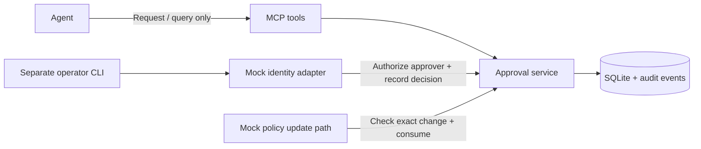

# OpenShell–Keyper Approval Lab

A working **local mock** of human approval for one exact sandbox network
change: allow `sandbox-demo` to reach `api.example.com:443` over TCP.

**Status:** MCP stdio, SQLite approval records, an independent operator CLI and
a mock policy-update adapter are implemented and tested. No real Keyper
authentication, OpenShell interceptor or network policy update is implemented.
OpenShell source remains untouched. This independent experiment does not imply
NVIDIA endorsement or an official partnership.

[繁體中文操作說明](docs/quickstart.zh-TW.md) · [Integration notes](docs/openshell-integration.md)

## Run the demo

Install Python 3.11+ and [uv](https://docs.astral.sh/uv/), then run from this repository:

```powershell
uv sync --locked
uv run python -m approval_lab.demo
uv run pytest -q
```

The demo starts a real MCP stdio subprocess and uses a separate CLI process for
the simulated human decision. It uses a temporary database, requires no API
keys, and changes no real policies. It asserts that an unapproved update fails,
an unauthorized identity fails, the correct human decision succeeds, a different
port fails, the exact update succeeds once, and a replay fails.

## How it works



The enforcement check lives in `mock_policy_update.py`, not in the agent's
interpretation of an MCP response. A status of `approved` is informational;
the update adapter must independently consume a matching, unused approval.

## The two MCP tools

| Tool | Inputs | Result |
| --- | --- | --- |
| `request_network_access` | `sandbox_id`, `domain`, `port`, `reason` | Request ID, `pending`, canonical change, fingerprint and expiry |
| `get_approval_status` | `request_id` | `pending`, `approved`, `denied` or `expired`, plus `consumed` and record details |

There is no MCP tool for approval, denial, consumption or policy updates.
Reasons are untrusted explanatory text, never authorization evidence.
After consumption, status remains `approved` and `consumed=true`; it is not
permission for another update. Unknown request IDs return a tool error.

Start the stdio server:

```powershell
uv run approval-lab-mcp
```

For a generic MCP host, use the command `uv` with these arguments, replacing
the example repository path with your own absolute path:

```json
{
  "mcpServers": {
    "approval-lab": {
      "command": "uv",
      "args": ["run", "--directory", "C:/path/to/openshell-keyper-lab", "approval-lab-mcp", "--db", "C:/path/to/approvals.sqlite3"]
    }
  }
}
```

This is a configuration example; no agent host configuration is modified by the
lab. The SDK is bounded to its maintained 1.x API (`mcp<2`); `uv.lock` records
the exact tested dependency versions. Do not upgrade to the SDK's 2.x API
without adapting and retesting the protocol integration.

## Review and decide from a separate terminal

Create a request through MCP, or use the equivalent CLI:

```powershell
uv run approval-lab request --sandbox sandbox-demo --domain api.example.com --port 443 --reason "Read the example API"
```

Set the returned ID, inspect the exact change, then simulate the human decision:

```powershell
$requestId = "paste-the-returned-request-id"
uv run approval-lab status $requestId
uv run approval-lab approve $requestId --identity demo-approver
uv run approval-lab apply $requestId --sandbox sandbox-demo --domain api.example.com --port 443
uv run approval-lab apply $requestId --sandbox sandbox-demo --domain api.example.com --port 443
uv run approval-lab audit $requestId
```

The first `apply` returns `applied=true, simulated=true`. The second returns
`already_consumed` and exit code 1. To deny a pending request, use
`uv run approval-lab deny $requestId --identity demo-approver`.

| Mock identity | Permission |
| --- | --- |
| `demo-approver` | Approve or deny pending network changes |
| `demo-viewer` | No approval authority |
| Any other name | Identity verification fails |

These names are test selectors, **not credentials**. Anyone with local CLI or
database access is a trusted operator in this mock. Do not deploy this mock as
an authentication service or treat it as isolation from an agent on the same OS.

The default database is `.approval-lab/approvals.sqlite3`, relative to the
process working directory. Use the same absolute `--db` path for MCP and CLI
when their working directories differ; `APPROVAL_LAB_DB` also sets the default.
Requests expire **five minutes after creation**, not five minutes after approval.

## Binding, single use and failure behavior

- The full supported change is canonical JSON containing `sandbox_id`, `domain`,
  `port`, `operation=network.allow`, and `protocol=tcp`, with a SHA-256 fingerprint.
  The simulator compares both contents and fingerprint before consumption.
- DNS names are ASCII (punycode for IDNs), case-insensitive, and normalized for
  one trailing root dot. URLs, paths, wildcards, IP addresses and port strings
  are rejected. This milestone does not implement DNS resolution or IP policy.
- SQLite `BEGIN IMMEDIATE` serializes decisions and consumption. Expiry is
  checked **after** acquiring the transaction. The one-time update and audit
  event commit together; failed auditing rolls back consumption.
- A mismatch does not burn the correct approval. Missing, denied, expired or
  consumed approvals fail closed, as do service, timeout and database errors.
- The simulator consumes before reporting a simulated update. A subsequent real
  gateway failure cannot be retried with that same approval; cross-system commit
  and retry semantics are explicitly deferred to the integration phase.

Audit records include request IDs, decisions, identity IDs, timestamps and
consumption results. Do not enter credentials or secrets in request reasons.
The database is a local lab log, not an immutable or remote audit service.

## Tests and next milestone

Tests cover all six initial acceptance criteria, concurrent consumption, audit
rollback, durable state, input validation, a complete CLI round trip and an
actual MCP stdio request/approval/query/update cycle.

Next, verify the real OpenShell policy-update RPC and interceptor payload before
implementing an external authenticated checker. Separately replace `MockIdentity`
with verified Keyper assertions. See [the integration questions and trust boundaries](docs/openshell-integration.md).

## References

- [Official MCP Python SDK, 1.x API used by this lab](https://github.com/modelcontextprotocol/python-sdk/tree/v1.x)
- [NVIDIA OpenShell](https://github.com/NVIDIA/OpenShell)
- [Gateway Interceptors](https://docs.nvidia.com/openshell/extensibility/gateway-interceptors)
- [OpenShell contribution guidelines](https://github.com/NVIDIA/OpenShell/blob/main/CONTRIBUTING.md)
