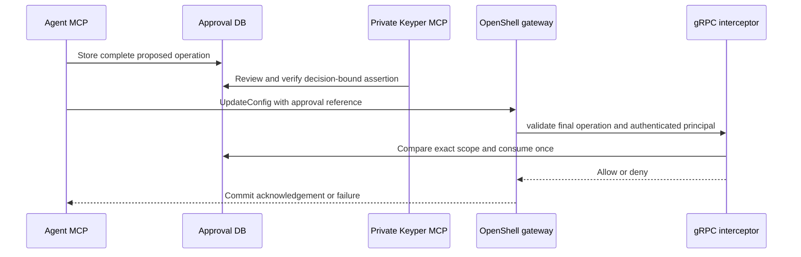

# OpenShell 最小 MCP 接線與 Keyper 接口

此版本已實作 OpenShell `UpdateConfig` gRPC 客戶端、`GatewayInterceptor` gRPC 服務、
獨立 Agent MCP 與私有人員核准 MCP。協定測試使用真正的 MCP stdio、TCP gRPC 和
固定版本 protobuf wire contract；測試中的 gateway 是 protocol peer，**不是 OpenShell runtime**。
後續已在獨立 Ubuntu VM 完成真實 OpenShell v0.1.6 驗收，包括政策載入與核准前後 HTTPS
連線，詳見 [真實驗收報告與重跑方式](live-validation.zh-TW.md)。本頁前述 protocol peer
仍用於快速測試；真實部署驗收是另外執行的獨立程序。

2026-10-29 驗證：獨立資料夾模式共 73 個測試通過；包含雙 MCP stdio 連線、gRPC
Describe/Evaluate/UpdateConfig、完整範圍比對、Keyper context 與角色限制、並發單次消耗、
過期、儲存故障、gateway 消耗後失敗，以及匯出 MCP schemas 與 runtime 一致性。
wheel 建置成功並確認包含 bridge、Keyper adapter、固定來源與授權文件。
這些證據沒有包含真實 OpenShell runtime 的連線結果。

## 在目前 Windows 專用資料夾重跑

```powershell
powershell.exe -NoProfile -ExecutionPolicy Bypass -File .\scripts\run-local-lab.ps1 -OpenShell
```

`-OpenShell` 安裝鎖定的 optional dependencies 並執行整合測試；不安裝 Docker、WSL 或
真實 OpenShell。協定測試的 gRPC 服務只在 loopback 隨機 port 暫時啟動，測試結束即停止。
Python 環境、依賴與報告仍留在 `.approval-lab/isolated-run`。

原本兩個網路規則 mock tools 仍可用；新的 bridge 是另一個明確啟動的 MCP server，
原本的 mock 核准不能當作真實 `UpdateConfig` 的核准。

## 接口分工

| 使用者 | MCP tool | 輸入與用途 |
| --- | --- | --- |
| Agent | `request_policy_update` | `operation`（受限的 UpdateConfig ProtoJSON）、`reason`，建立五分鐘有效的申請 |
| Agent | `get_policy_approval` | `request_id`，取得完整審閱內容與狀態 |
| Agent | `submit_approved_policy` | 只接受 `request_id`；載入原先核准的內容再呼叫固定 gateway |
| 私有操作端／Keyper | `get_policy_review` | `request_id`、`approve`，取得完整內容、decision context 與 challenge |
| 私有操作端／Keyper | `decide_policy_update` | `request_id`、`approve`、`assertion`，由可信 Keyper verifier 驗證後記錄決定 |

Agent server 不提供 approve/deny，也不接受核准布林值或新 operation 作為 submit 參數。
Keyper 不必直接呼叫 OpenShell；完成驗證器後，核准流程及 OpenShell adapter 不需重寫。

可分別使用 [Agent MCP 設定範本](../examples/openshell/agent-mcp.example.json) 與
[Keyper 操作端 MCP 設定範本](../examples/openshell/keyper-operator-mcp.example.json)。
兩份範本屬於不同的可信 host，不能合併掛給同一個申請 Agent；Windows 的 command
可換成資料夾 lab 輸出的 `venv/Scripts/python.exe`。
實際 MCP tools 的 [Agent schema](../examples/openshell/agent-tools.schema.json) 與
[Keyper operator schema](../examples/openshell/operator-tools.schema.json) 已匯出，
並以測試確認與 runtime 一致，可直接提供給 Keyper 團隊。



## 已實作的限制

- 僅接受明確 workspace、sandbox、非零 `expectedResourceVersion`，以及一筆 `addRule`。
- 每筆只允許一個 ASCII DNS host、一個 port、`tcp`、一個絕對 Linux binary path。
- 不支援全域政策、整份政策替換、其他 setting、L7、wildcard、IP 或其他 merge 操作。
- 固定 gateway 身分及完整 authenticated principal map 由操作者設定，不能由 Agent 選擇。
- 使用 protobuf 正規化後的完整操作、principal 與 gateway ID 計算指紋。
- bridge 自行產生 durable `requestId`；annotation `approval-lab.example/request-id` 只攜帶參照。
  gateway 不會自行信任此 annotation；必須啟用本攔截器。
- 最終操作若被其他 modify interceptor 改動，就無法匹配核准；消耗發生在 validate。
- 消耗與 SQLite 稽核在同一交易內，重放及並發只能成功一次；gateway 失敗不恢復核准。
- 提交成功只表示 gateway 回覆；不宣稱 sandbox 已載入新政策或網路已通。

目前將一次 `UpdateConfig` 的完整內容交給人審閱，不嘗試從缺少 current_state 的 evaluation
推論權限差異。ruleName 若已存在、binary 比對、版本競爭仍須由實際 gateway 驗證。

## 真實 Linux 測試機接線

尚無測試機時，可先以 `python scripts/package-deployable.py` 保留來源交付包。
ZIP 與 SHA-256 檔案寫入 `.approval-lab/releases/`；內含逐檔雜湊 manifest，
不含 `.git`、虛擬環境、快取、核准資料庫、測試機憑證或私密設定。
交付包不含離線套件，未來首次安裝仍需要網路，以及預先存在的 Python 3.11+ 與 uv。

取得獨立 Linux 測試機後，解壓縮並執行：

```bash
bash scripts/prepare-linux-lab.sh
```

此腳本只建立專案內的專用環境並跑協定測試，不安裝系統套件或自動啟動 gateway。
Linux 準備腳本已在 Ubuntu 24.04 實跑，73 個測試通過；真實部署繼續依下列步驟設定。

先使用可丟棄的獨立 Linux 測試機。實際部署前確認 OpenShell 版本對應
`4d4c15c133d40a50234ce9d2d198e5ba79b9553e` 的 API；其他版本需重新比對。
不要把本機 Windows venv 複製到 Linux。

```bash
uv sync --locked --extra openshell
mkdir -m 700 -p .approval-lab/private
cp examples/openshell/config.example.json .approval-lab/private/config.json
cp examples/openshell/add-network-rule.json .approval-lab/private/operation.json
```

修改 config 的 TLS gateway 位址、CA 路徑、gateway_id 及 **實際 gateway principal map**；
範本的 kind/subject 僅示意，不能猜測或略過比較。若 map 不同，攔截器應拒絕而不是放寬。
可在受控測試 gateway 的去識別診斷中取得 principal；此版本不提供「信任首次呼叫」功能。
操作範本也必須修改成存在的 workspace、sandbox、目前 resource version、可控制的測試 host
以及 sandbox 中真實 binary path。`api.example.com` 只是不可作連線成功驗收的範例。

先啟動 interceptor（與 gateway 共用私有 socket 目錄，同一可信作業系統使用者）：

```bash
uv run --locked --extra openshell python -m approval_lab.openshell_mcp interceptor \
  --config "$PWD/.approval-lab/private/config.json" \
  --db "$PWD/.approval-lab/private/bridge.sqlite3" \
  --listen "unix:$PWD/.approval-lab/private/interceptor.sock"
```

此里程碑只實作私有 Unix socket 的部署方式；沒有實作對外 network interceptor 的 gateway JWT
驗證。TCP listener 須明確指定 `--local-insecure` 且限制 loopback，僅供本機協定測試。
Unix socket 的父目錄必須是私有權限；若 gateway 在容器中，須把該 socket 目錄映射到
gateway 可存取的位置並處理 UID 權限，不能因此掛載整個家目錄或正式系統 Docker socket。

依 [官方攔截器文件](https://docs.nvidia.com/openshell/extensibility/gateway-interceptors)
加入 gateway TOML 並重啟。以下是待實測的設定範本，路徑須換成 gateway 看得到的絕對路徑：

```toml
[[openshell.gateway.interceptors]]
name = "approval-lab"
grpc_endpoint = "unix:///absolute/private/interceptor.sock"
order = 100
failure_policy = "fail_closed"
binding_policy = "exact"
timeout = "2s"

[[openshell.gateway.interceptors.bindings]]
rpc = "openshell.v1.OpenShell/UpdateConfig"
phases = ["validate"]
```

先確認 gateway 啟動時接受 Describe manifest 與 protocol 1.0 協商。客戶端支援 TLS、
選填 mTLS（config 中 `client_cert`、`client_key`）及 `bearer_env` 指定的環境變數；
不將 token 放進 JSON、MCP 參數或命令列。憑證只留在測試機。

### 真正送出最小流程

先不帶 `--submit`，只建立申請與檢查 operation：

```bash
uv run --locked --extra openshell python -m approval_lab.openshell_smoke \
  --config .approval-lab/private/config.json --db .approval-lab/private/bridge.sqlite3 \
  --operation .approval-lab/private/operation.json
```

測試環境明確使用 mock 身分，再建立新申請並實際送出：

```bash
uv run --locked --extra openshell python -m approval_lab.openshell_smoke \
  --config .approval-lab/private/config.json --db .approval-lab/private/bridge.sqlite3 \
  --operation .approval-lab/private/operation.json --submit --local-mock-keyper
```

這個命令會修改已設定測試 gateway 的政策。輸出應含 `submitted=true`、gateway revision，
以及 `runtime_policy_loaded=false`。若 gateway 沒有消耗核准卻回成功，客戶端會回報部署異常；
此時政策可能已提交，不可當作回滾，應檢查部署。
若 validate 後 gateway 回 ABORTED 或逾時，核准可能已消耗，須重新讀取政策版本與重新申請；
本版不自動重試、不恢復核准。OpenShell durable request ID 的跨失敗重試尚未驗收。

### 驗收完成的判準

除提交成功外，必須另外保存：未核准的直接 UpdateConfig 被拒、核准後 runtime 回報政策
載入成功、指定 binary 可連到可控制的測試 host、其他 host/binary 仍被阻擋的證據。
本攔截器目前只治理 UpdateConfig，**不宣稱完整治理 CreateSandbox、全域管理或政策草稿等其他路徑**。
測試帳號與環境必須限制其他管理路徑；完整企業部署仍須完成繞過路徑盤點。

## Keyper 團隊接入

操作端 MCP 以 stdio 啟動，單獨配置給可信的人員操作 UI 或 Keyper host：

```bash
uv run --locked --extra openshell python -m approval_lab.openshell_mcp operator \
  --config .approval-lab/private/config.json --db .approval-lab/private/bridge.sqlite3 \
  --keyper-verifier your_keyper_package.adapter:create_verifier
```

1. UI 呼叫 `get_policy_review(request_id, approve)`，顯示完整操作及 fingerprint。
2. Keyper 驗證人員，並將本次 `challenge` 綁進可驗證的證明。
3. UI 呼叫 `decide_policy_update(request_id, approve, assertion)`。
4. 可信 verifier 使用官方 SDK 驗證證明與 challenge，再回傳 `Identity(subject, roles)`。
5. 服務另檢查 `network_approver` 角色及申請到期狀態，交易式記錄決定。

Python 介面為 `verify_decision(assertion: str, context: DecisionContext) -> Identity`。
challenge 是帶 purpose 的 canonical JSON（request_id、完整操作 fingerprint、approve、expires_at）
之 SHA-256 hex；approve/deny 的 challenge 不同。它不是秘密或簽章，單獨回傳 challenge
不能當作真實身分證明。完整定義見 `keyper_adapter.py`。

可從 [拒絕預設的 adapter 範本](../examples/keyper_adapter_template.py) 開始。
沒有設定 verifier 時回 `keyper_not_configured`。只有明確使用 `--local-mock-keyper`
才接受 demo 身分。`--keyper-verifier` 是可信部署參數，不是 Agent 可指定的 tool argument。
證明不得寫入 log；操作端 UI、MCP host 與 verifier 也須避免記錄原始 assertion。

### 安全邊界

此實驗的 Agent MCP、operator 與 interceptor 仍可使用同一個本機 DB，適用於可信 lab host。
能直接讀寫 DB 或執行原本 mock CLI 的作業系統使用者，是可信操作者，不能宣稱能抵抗
同權限惡意 Agent。正式環境須把 DB 與 Keyper verifier 放在獨立可信服務，改成受驗證的
申請/查詢/決策 API，並將 Agent 與操作端權限隔離；不要把此 DB 掛入 sandbox。
